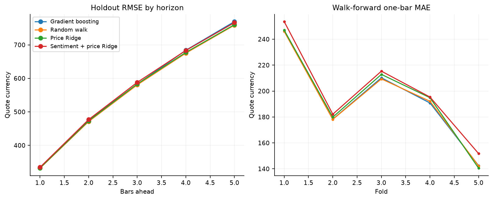

# CrowdWisdomTrading | X sentiment and price forecasting

**Did X sentiment help?** In the historical BTC-USD experiment, adding FinBERT-scored tweets to the same Ridge regression reduced walk-forward MAE at **one of five horizons**. On the final chronological holdout, it increased MAE and RMSE at **all five horizons**. The tree model ranked first on pooled development return RMSE. Its one-hour MAE still exceeded random walk. The price/sentiment ablation provides no reliable evidence of incremental forecasting value in this sample.

| Research output | Where to look |
|---|---|
| Methods, all four models, five horizons, trading and limitations | [Evaluation report](reports/evaluation_report.md) |
| Latest available close, current sentiment coverage and five price-only projections | [Current outlook](reports/sentiment_outlook.md) |
| All 12 catalogue entries, sizes, access verification, date integrity and selection | [Dataset discovery](reports/dataset_discovery_report.md) |
| Historical forecasts and ablation results | [Forecast matrix](reports/historical/forecast_horizon_matrix.csv) · [Paired comparisons](reports/historical/incremental.csv) |
| Static research figures | [Figures](reports/figures/) |
| Separate daily StockTwits experiment | [Supplementary report](reports/stocktwits/evaluation_report.md) |
| Provenance, environment and checksums | [Submission manifest](reports/reproducibility_manifest.json) · [Verification](docs/verification.md) · [Private credential checklist](docs/submission.md) |



## Evidence

Experiment B used **20,243 scored posts**, 4,320 actual hourly candles and 4,243 labelled origins between February and August 2021. Of the 4,248 feature rows after warmup, 3,103 lacked sampled posts. Five expanding validation blocks produced 1,402 OOS origins, followed by a separately purged 721-origin holdout. FinBERT probabilities, native StockTwits labels and VADER lexical weights are identified separately.

The selected gradient-boosting long/cash rule made 27 development trades. After 10 bp per side, it returned **3.00%**, with annualized Sharpe **0.72**, Sortino **1.03** and maximum drawdown **−7.45%**. It made zero final-holdout trades. Holdout return and drawdown were zero, and both ratios were undefined.

Experiment A requires recent Apify posts. Experiment C also requires defensible source continuity. Neither has a measured X result. The current price-only control used a separate recent Yahoo sample and independently selected its model. One live Tavily search stored 10 articles, of which three dated headlines are cited in the outlook. Experiment D used only StockTwits and daily Coinbase prices.

## Install and verify offline

Python 3.12 was used. On Windows, replace `python` below with `.\.venv\Scripts\python.exe` after creating the environment. On POSIX, use `.venv/bin/python` or activate the environment.

```sh
python -m venv .venv
# Activate the environment or use its interpreter for the remaining commands.
python -m pip install -e .
python -m xsentiment doctor
python -m unittest discover -s tests -v
python -m xsentiment demo
python scripts/verify_run.py runs/demo
```

The seeded demo generates synthetic fixtures, uses VADER, and performs no network requests. It runs the same database, feature, model, trading and reporting path. `run` and `run-all` both execute feature building, training, walk-forward evaluation, forecasting and reporting as one consistent experiment. Use a fresh demo database and output path for a second demo. The demo's metrics have no empirical market interpretation.

## Reproduce historical X

The source is the publisher's original timestamped Bitcoin main CSV in its v54 ZIP. The Google Doc is a catalogue. The helper streams the ZIP to disk, verifies its SHA-256 and retrieves the pinned local financial model. Model weights and individual tweet text are excluded from Git. The checked-in 15 public Coinbase response pages reproduce the historical price feed offline.

```sh
python -m pip install -e ".[finbert]"
python scripts/fetch_research_inputs.py --live
python -m xsentiment prepare-history data/downloads/bitcoin-tweets-v54.zip --db data/database/experiment-b.sqlite
python -m xsentiment ingest --only prices --provider coinbase --cached --raw reference/coinbase --start 2021-02-06 --end 2021-08-05 --db data/database/experiment-b.sqlite
python -m xsentiment --config config/historical.toml run-all --experiment B --db data/database/experiment-b.sqlite --out runs/reproduced-b
python scripts/verify_run.py runs/reproduced-b
```

FinBERT uses the ProsusAI revision recorded in the manifest. CPU inference batches up to 32 texts at a time and caches probabilities by text and model/tokenizer hashes. The pinned local artifact was distributed after the evaluated trading period. This is a retrospective text-measurement experiment. A lightweight run omits `--config config/historical.toml` to select VADER. Use a distinct output path when changing engines.

For any completed local run, the following verifies the canonical input file hashes and rebuilds everything without provider requests. A FinBERT replay needs the already-downloaded local weights. Published subsets contain derived outputs; use the reconstruction above to restore individual input snapshots. Collection and fit timestamps and their provenance hashes can differ across fresh acquisitions.

```sh
python -m xsentiment replay runs/reproduced-b --db data/database/replay-b.sqlite --out runs/replay-b
```

## Collect recent X, prices and news

Copy `.env.example` to a local `.env`. Set APIFY_TOKEN and TAVILY_API_KEY, and optionally EXA_API_KEY. News is available to the outlook only. The default official-client integration uses Actor `apidojo~tweet-scraper`. APIFY_ACTOR_ID and APIFY_INPUT_FILE configure alternatives. The JSON example demonstrates the published default schema. For an alternative Actor, supply a credential-free input template matching its documentation and confirm its output maps to the documented post aliases. Template values support `{query}`, `{ticker}`, `{company}`, `{start}`, `{end}` and numeric `{limit}`. [Reviewed Actor schema](https://apify.com/apidojo/tweet-scraper/input-schema) · [SDK references](docs/data_sources.md).

```sh
python -m xsentiment ingest --only prices --provider yahoo --days 180 --live
python -m xsentiment ingest --only x --days 180 --items-per-day 300 --budget-usd 5 --live
python -m xsentiment ingest --only news --live
python -m xsentiment --config config/historical.toml run --experiment A --db data/database/recent.sqlite --out runs/recent-a
```

The USD 5 Apify example is a total cap, divided across UTC date slices. Collection volume depends on the Actor, pricing, credit and daily caps. Specify the same `--end` on price and post requests for a frozen window. Failed or incomplete jobs are recorded in ingestion_runs. On an ambiguous start, reconcile the run ID in Apify Console before retrying. Raw pages persist even when later processing fails. A resumed successful start reads the same dataset. Exa is supplemental to Tavily.

With prices alone, a separate recent control evaluates random walk and price-only Ridge on recent expanding folds and fits the selected model on matured recent labels. The command writes the observed reference, five projected closes, UTC target times, empirical holdout error and the X/news coverage status.

```sh
python -m xsentiment current --research reports/historical --db data/database/recent.sqlite --out runs/current
```

## Import another asset or dataset

Edit a TOML `[research]` section using the fields in [Config](src/xsentiment/config.py). Set asset, ticker, company, keywords, exchange, timezone, interval, optional start/end, availability, min_train, test_size, holdout and embargo. Use a distinct database per asset and bar definition. The XNYS calendar with America/New_York supports session opens, holidays, DST and partial closes. Use `24/7` for crypto. Hourly (`1h`) and daily (`1d`) Yahoo bars are supported. Missing scheduled bars stop the analysis. Download a suitable frequency if a provider cannot serve older intraday history.

```sh
python -m xsentiment --config config/historical.toml import-posts data/raw/export.csv --dataset my-archive-v1 --license CC0-1.0 --db data/database/import.sqlite
```

Supply a genuine, asset-specific export at the path shown. CSV and JSONL are streamed, and JSON arrays are intended for small exports. Use the source's actual license. The importer reads text/full_text/content, createdAt/created_at/date/timestamp and id/id_str. UTC Unix seconds and milliseconds are supported. Naive dates mean UTC; convert a local-time source with its documented timezone before import. Nested Apify author metadata and flat author fields are supported. For unsourced post IDs, preserve the null original ID and create a stable content key. Optional `available_at` delays feature use. Publication-time reconstruction is explicit; `availability="first_seen"` additionally requires historical collector observations. Repeated imports retain the first acquisition. A historical price request without an explicit window extends its start to stored post history. Mixed assets must be partitioned by their actual source tags before import.

Select repeatable source subsets with repeated `--dataset` arguments to `run`. A uses Apify X, B uses historical X, C requires both with contiguous source coverage, and D requires a separate StockTwits configuration. The model only sees the explicit price and sentiment column lists. Target columns, news, exchange volume and retrospective engagement have no route into the predictors.

## Reproduce StockTwits separately

```sh
python scripts/sample_stocktwits.py
python scripts/prepare_stocktwits.py --prices-db data/database/experiment-b.sqlite
python -m xsentiment --config config/stocktwits.toml run --experiment D --db data/database/experiment-d.sqlite --out runs/reproduced-d
```

The first command retrieves public, bounded byte ranges from the publisher's labelled shards. The preparation step uses BTC.X labels and converts only complete groups of 24 historical hourly candles into daily bars. The conservative date-availability delay reflects the missing intraday timestamp. The resulting 17-origin holdout provides limited statistical precision.

## Storage and audit

SQLAlchemy Core defines raw_tweets, normalized_posts, processed_tweets, price_bars, news_articles, sentiment_features, model_features, predictions, evaluation_metrics, ingestion_runs and experiments. SQLite-specific upserts live in the repository module. Each experiment has a version tied to its inputs, source code, configuration and library versions. The database contains both OOS and latest deployment predictions; forecast.json identifies the actual fit time, observed cutoff and selected specification.

The local Windows environment is recorded in requirements-lock.txt. The portable package dependencies and optional financial-model extra are in pyproject.toml. Full local run manifests verify input snapshots, fitted models, plots and CSVs. The submission manifest verifies the report subset shared on GitHub. [Submission checklist](docs/submission.md).
