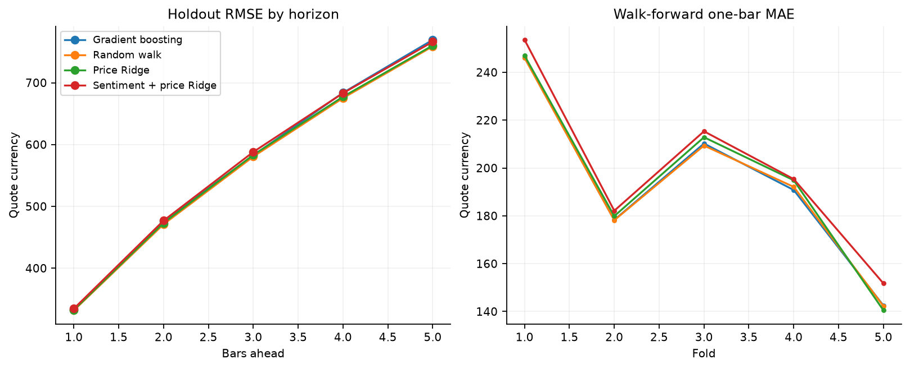
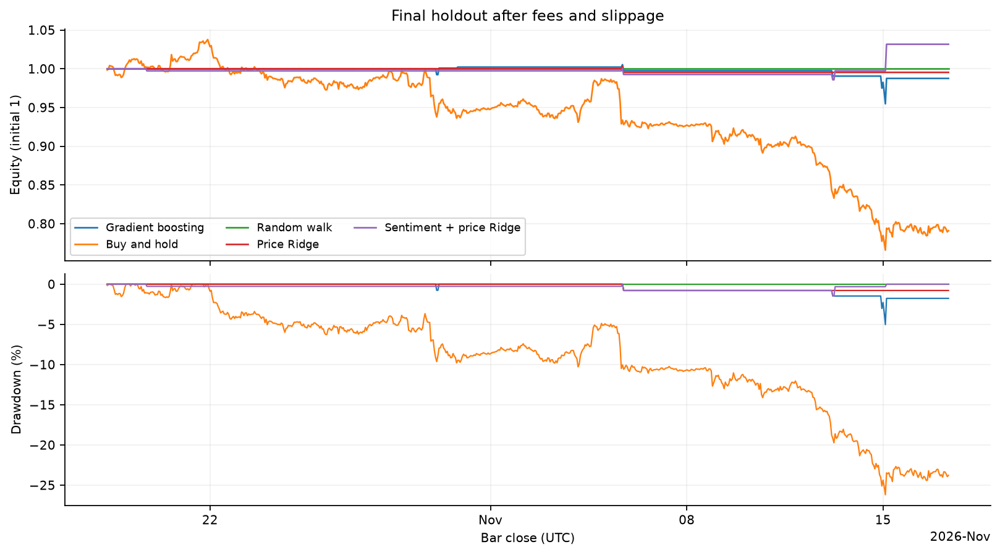

# BTC-USD | Does X sentiment improve hourly forecasts?

**REAL DATA**. Adding X sentiment to Ridge reduced walk-forward MAE at 0/5 horizons and RMSE at 0/5. On the final holdout the counts were 0/5 and 0/5. At 0/5 horizons the paired holdout interval for MAE reduction lay entirely above zero. The sample provides no clear evidence of a repeatable reduction in absolute forecast error.

**Validation selected persistence** by pooled forward log-return RMSE with equal weight per origin and horizon. Selection scores used only walk-forward labels maturing before the final holdout. The model was then frozen for the final block.

## Data and availability

The 1h sample contains 4,320 completed bars from 2026-05-21T13:00:00+00:00 through 2026-11-17T12:00:00+00:00. 414 source posts yielded 401 scored observations. ID duplicates within the aligned window totalled 0, repeated cleaned texts 11, and empty or off-topic texts 2. After 72 bars of warmup, 4,248 origins remained, including 3,882 without posts. Coverage was 8.6%. 4,243 origins had all five matured targets. Price sources: yfinance.

Apify Actor coregent~x-tweet-scraper supplied a capped sample across 2 runs. The manifest contains the actual query inputs, run and dataset IDs, and charge records. Coregent searches return relevance-ranked results within each date stratum. Retrospective ranking can depend on popularity accumulated after publication. Market-wide post volume and the set of posts visible to a contemporaneous collector are unknown.

Posts are grouped strictly before each close. A reported availability time delays a post. The run used the publication policy. Publication-time reconstruction assumes archived text could have been read at publication. Retrospective deletions, edits and collection delays remain unobservable. First-seen mode requires a collector observation before the origin. Engagement, follower snapshots, exchange volume and news are excluded from both model matrices.

## Sentiment and supervised models

The sentiment engine was finbert. FinBERT uses positive minus negative softmax probability and the most likely class. The lightweight VADER option uses normalized lexical weights and a ±0.05 polarity band. StockTwits uses its own binary label. Missing intervals retain undefined sentiment, zero sampled posts and an explicit presence indicator. Returns, acceleration, trading ranges, rolling extremes, volatility and moving-average ratios use trailing prices. Sentiment aggregates include dispersion, proportions, imbalance, lags, momentum and log counts. Observed neutral posts remain in their interval.

Five direct targets are log(close[t+h]/close[t]). Multiplying the observed n+0 close by the exponential of each predicted return gives the price forecast. Random walk, price Ridge, price + sentiment Ridge (alpha 100) and five regularized gradient-boosting estimators use identical origins. Ridge fits median imputation, missingness indicators and scaling separately on each training fold. Boosting handles missing values natively, with 45 iterations, at most seven leaves and fixed seed. Observable future closes provide supervised labels. Learning a reinforcement policy would require an execution and reward environment that these data do not identify.

## Expanding-window evaluation

The table gives realized fold sizes. Each fit purges five origins plus 0 embargo bars. The last development test label also precedes the first final holdout origin. Model settings were fixed. The final block is held out within this protocol. This repository had previously evaluated an earlier specification on the historical period, which limits its status as independently unseen evidence.

| fold | phase | train_rows | test_rows | last_train_label | test_start | last_test_label |
| --- | --- | --- | --- | --- | --- | --- |
| 1 | walk_forward | 2110 | 336 | 2026-08-20T15:00:00+00:00 | 2026-08-20T16:00:00+00:00 | 2026-09-03T20:00:00+00:00 |
| 2 | walk_forward | 2446 | 336 | 2026-09-03T15:00:00+00:00 | 2026-09-03T16:00:00+00:00 | 2026-09-17T20:00:00+00:00 |
| 3 | walk_forward | 2782 | 336 | 2026-09-17T15:00:00+00:00 | 2026-09-17T16:00:00+00:00 | 2026-10-01T20:00:00+00:00 |
| 4 | walk_forward | 3118 | 336 | 2026-10-01T15:00:00+00:00 | 2026-10-01T16:00:00+00:00 | 2026-10-15T20:00:00+00:00 |
| 5 | walk_forward | 3454 | 58 | 2026-10-15T15:00:00+00:00 | 2026-10-15T16:00:00+00:00 | 2026-10-18T06:00:00+00:00 |
| 6 | holdout | 3517 | 721 | 2026-10-18T06:00:00+00:00 | 2026-10-18T07:00:00+00:00 | 2026-11-17T12:00:00+00:00 |

## Incremental value of sentiment

Adding X sentiment to Ridge reduced walk-forward MAE at 0/5 horizons and RMSE at 0/5. On the final holdout the counts were 0/5 and 0/5. At 0/5 horizons the paired holdout interval for MAE reduction lay entirely above zero. The sample provides no clear evidence of a repeatable reduction in absolute forecast error. Positive gains favor adding sentiment. Direction gains are percentage points. Paired 95% percentile intervals use 500 circular moving-block resamples of the absolute loss difference. Block lengths exceed or equal the forecast horizon. Intervals are descriptive and unadjusted for testing multiple horizons. Fold wins count lower MAE.

| phase | horizon | rmse_gain_usd | mae_gain_usd | direction_gain_pp | mae_ci_low | mae_ci_high | block_bars | winning_folds | folds |
| --- | --- | --- | --- | --- | --- | --- | --- | --- | --- |
| holdout | 1 | -2.0046 | -3.6539 | -3.4674 | -6.9727 | -1.1298 | 9 | 0 | 1 |
| holdout | 2 | -3.7353 | -8.0875 | -2.6352 | -13.9576 | -2.3078 | 9 | 0 | 1 |
| holdout | 3 | -4.8729 | -9.5327 | -3.0513 | -17.6219 | -0.9135 | 9 | 0 | 1 |
| holdout | 4 | -5.7692 | -13.6899 | -5.4092 | -26.7101 | -1.6717 | 9 | 0 | 1 |
| holdout | 5 | -5.9743 | -16.5667 | -7.0735 | -31.3145 | -1.3969 | 9 | 0 | 1 |
| walk_forward | 1 | -1.9613 | -3.3082 | 1.1412 | -5.4164 | -1.4079 | 12 | 0 | 5 |
| walk_forward | 2 | -3.3249 | -5.8433 | 3.7090 | -10.1280 | -1.6422 | 12 | 0 | 5 |
| walk_forward | 3 | -6.0777 | -7.6510 | 1.8545 | -15.0298 | -1.0380 | 12 | 0 | 5 |
| walk_forward | 4 | -8.7381 | -11.7860 | 2.3538 | -20.7256 | -2.7406 | 12 | 1 | 5 |
| walk_forward | 5 | -11.0641 | -15.6032 | 3.7090 | -27.5839 | -2.5329 | 12 | 0 | 5 |

## Out-of-sample forecast errors

MAE, RMSE and mean signed error use price units. Both price-level and return R² are reported because a persistent price level can produce a high R² with little return predictability. Direction is exact sign agreement, including a zero-return forecast. Positive MAE skill indicates an improvement over random walk.

| phase | model | horizon | n | mae_usd | rmse_usd | r2_price | r2_return | mean_error_usd | direction_accuracy | mae_skill_vs_persistence |
| --- | --- | --- | --- | --- | --- | --- | --- | --- | --- | --- |
| holdout | boosting | 1 | 721 | 217.0247 | 333.4440 | 0.9959 | -0.0145 | 15.5790 | 0.5201 | -0.0079 |
| holdout | boosting | 2 | 721 | 314.1542 | 476.0395 | 0.9917 | -0.0258 | 45.6270 | 0.5062 | -0.0220 |
| holdout | boosting | 3 | 721 | 382.1894 | 582.4645 | 0.9877 | -0.0123 | 68.7041 | 0.5076 | -0.0077 |
| holdout | boosting | 4 | 721 | 455.8994 | 683.7884 | 0.9832 | -0.0441 | 89.6880 | 0.4813 | -0.0208 |
| holdout | boosting | 5 | 721 | 520.9490 | 769.3742 | 0.9788 | -0.0513 | 101.5774 | 0.5104 | -0.0253 |
| holdout | persistence | 1 | 721 | 215.3157 | 331.8077 | 0.9960 | -0.0051 | 23.4820 | 0.0000 | 0.0000 |
| holdout | persistence | 2 | 721 | 307.3822 | 471.1357 | 0.9919 | -0.0108 | 47.4735 | 0.0000 | 0.0000 |
| holdout | persistence | 3 | 721 | 379.2576 | 580.5315 | 0.9878 | -0.0163 | 71.5282 | 0.0000 | 0.0000 |
| holdout | persistence | 4 | 721 | 446.6226 | 675.1846 | 0.9836 | -0.0223 | 96.5022 | 0.0000 | 0.0000 |
| holdout | persistence | 5 | 721 | 508.1108 | 758.7499 | 0.9794 | -0.0275 | 120.1558 | 0.0000 | 0.0000 |
| holdout | price_only | 1 | 721 | 214.4967 | 332.6275 | 0.9959 | -0.0065 | 22.7468 | 0.5298 | 0.0038 |
| holdout | price_only | 2 | 721 | 307.2082 | 473.2190 | 0.9918 | -0.0133 | 45.7802 | 0.5257 | 0.0006 |
| holdout | price_only | 3 | 721 | 379.8605 | 583.1762 | 0.9877 | -0.0176 | 68.5743 | 0.5298 | -0.0016 |
| holdout | price_only | 4 | 721 | 446.2254 | 677.3798 | 0.9835 | -0.0205 | 91.0874 | 0.5437 | 0.0009 |
| holdout | price_only | 5 | 721 | 507.5760 | 760.2645 | 0.9793 | -0.0230 | 111.2031 | 0.5492 | 0.0011 |
| holdout | sentiment_price | 1 | 721 | 218.1507 | 334.6321 | 0.9959 | -0.0187 | 12.4693 | 0.4951 | -0.0132 |
| holdout | sentiment_price | 2 | 721 | 315.2956 | 476.9543 | 0.9917 | -0.0301 | 27.9410 | 0.4993 | -0.0257 |
| holdout | sentiment_price | 3 | 721 | 389.3931 | 588.0491 | 0.9875 | -0.0352 | 43.4596 | 0.4993 | -0.0267 |
| holdout | sentiment_price | 4 | 721 | 459.9153 | 683.1490 | 0.9832 | -0.0390 | 59.7092 | 0.4896 | -0.0298 |
| holdout | sentiment_price | 5 | 721 | 524.1428 | 766.2388 | 0.9790 | -0.0409 | 75.0048 | 0.4785 | -0.0316 |
| walk_forward | boosting | 1 | 1402 | 203.7384 | 315.6573 | 0.9898 | -0.0021 | -3.3201 | 0.4979 | 0.0001 |
| walk_forward | boosting | 2 | 1402 | 288.5940 | 443.0021 | 0.9799 | -0.0140 | -10.3915 | 0.5221 | -0.0080 |
| walk_forward | boosting | 3 | 1402 | 355.3340 | 537.4917 | 0.9703 | -0.0117 | -13.6949 | 0.5257 | -0.0047 |
| walk_forward | boosting | 4 | 1402 | 416.0274 | 619.2635 | 0.9603 | -0.0220 | -20.4593 | 0.5271 | -0.0168 |
| walk_forward | boosting | 5 | 1402 | 471.6994 | 688.7761 | 0.9507 | -0.0235 | -29.7393 | 0.5335 | -0.0205 |
| walk_forward | persistence | 1 | 1402 | 203.7561 | 315.3471 | 0.9899 | -0.0005 | -6.5004 | 0.0000 | 0.0000 |
| walk_forward | persistence | 2 | 1402 | 286.3084 | 440.1750 | 0.9802 | -0.0009 | -12.8407 | 0.0000 | 0.0000 |
| walk_forward | persistence | 3 | 1402 | 353.6705 | 534.6787 | 0.9706 | -0.0014 | -19.3510 | 0.0000 | 0.0000 |
| walk_forward | persistence | 4 | 1402 | 409.1358 | 613.0882 | 0.9611 | -0.0020 | -25.9711 | 0.0000 | 0.0000 |
| walk_forward | persistence | 5 | 1402 | 462.2100 | 681.3153 | 0.9518 | -0.0025 | -32.3896 | 0.0000 | 0.0000 |
| walk_forward | price_only | 1 | 1402 | 205.8242 | 317.1023 | 0.9898 | -0.0100 | -5.9619 | 0.4979 | -0.0101 |
| walk_forward | price_only | 2 | 1402 | 293.3164 | 444.8044 | 0.9797 | -0.0198 | -10.5438 | 0.4786 | -0.0245 |
| walk_forward | price_only | 3 | 1402 | 362.4013 | 541.2570 | 0.9699 | -0.0226 | -15.0650 | 0.4936 | -0.0247 |
| walk_forward | price_only | 4 | 1402 | 418.8029 | 621.2412 | 0.9601 | -0.0242 | -19.0023 | 0.5036 | -0.0236 |
| walk_forward | price_only | 5 | 1402 | 472.3162 | 690.3547 | 0.9505 | -0.0237 | -22.6219 | 0.5000 | -0.0219 |
| walk_forward | sentiment_price | 1 | 1402 | 209.1324 | 319.0636 | 0.9896 | -0.0234 | -5.0588 | 0.5093 | -0.0264 |
| walk_forward | sentiment_price | 2 | 1402 | 299.1597 | 448.1293 | 0.9794 | -0.0364 | -9.3263 | 0.5157 | -0.0449 |
| walk_forward | sentiment_price | 3 | 1402 | 370.0523 | 547.3347 | 0.9692 | -0.0473 | -13.2173 | 0.5121 | -0.0463 |
| walk_forward | sentiment_price | 4 | 1402 | 430.5888 | 629.9794 | 0.9590 | -0.0552 | -16.9467 | 0.5271 | -0.0524 |
| walk_forward | sentiment_price | 5 | 1402 | 487.9194 | 701.4188 | 0.9489 | -0.0588 | -19.9919 | 0.5371 | -0.0556 |

## Trading simulation

The one-bar forecast sets a long/cash position. Each training fold sets the entry threshold to the larger of the median absolute one-bar training log return and two one-way costs. Enter at the next bar open, liquidate at its close, with unit maximum exposure and no borrowing. One-way cost is 10 bp including 2 bp of slippage. Each active bar is one round trip, even for consecutive signals. The historical opening print is a fill assumption, especially for adjacent crypto bars. Buy-and-hold enters once and exits once per phase. Sharpe uses sample standard deviation and 8760 periods per year. Sortino uses the root mean squared negative return across all bars. Both use a zero hurdle. Drawdown includes initial wealth. Gross and net are reported separately. Annualized growth rates extrapolate short samples.

**Selected model, final holdout, net of costs**

| phase | model | basis | sharpe | sortino | max_drawdown | total_return | annualized_return | bars | trades | win_rate | turnover | exposure |
| --- | --- | --- | --- | --- | --- | --- | --- | --- | --- | --- | --- | --- |
| holdout | persistence | net | N/A | N/A | 0.0000 | 0.0000 | 0.0000 | 721 | 0 | N/A | 0.0000 | 0.0000 |

| phase | model | basis | sharpe | sortino | max_drawdown | total_return | annualized_return | bars | trades | win_rate | turnover | exposure |
| --- | --- | --- | --- | --- | --- | --- | --- | --- | --- | --- | --- | --- |
| holdout | boosting | gross | 0.7932 | 1.5281 | -0.0388 | 0.0095 | 0.1223 | 721 | 11 | 0.4545 | 22.0000 | 0.0153 |
| holdout | boosting | net | -0.8618 | -1.3946 | -0.0503 | -0.0124 | -0.1410 | 721 | 11 | 0.4545 | 22.0000 | 0.0153 |
| holdout | persistence | gross | N/A | N/A | 0.0000 | 0.0000 | 0.0000 | 721 | 0 | N/A | 0.0000 | 0.0000 |
| holdout | persistence | net | N/A | N/A | 0.0000 | 0.0000 | 0.0000 | 721 | 0 | N/A | 0.0000 | 0.0000 |
| holdout | buy_hold | gross | -6.5050 | -8.5458 | -0.2619 | -0.2074 | -0.9407 | 721 | 1 | 0.0000 | 2.0000 | 1.0000 |
| holdout | buy_hold | net | -6.5638 | -8.6207 | -0.2619 | -0.2090 | -0.9421 | 721 | 1 | 0.0000 | 2.0000 | 1.0000 |
| holdout | price_only | gross | 0.5966 | 0.8243 | -0.0058 | 0.0013 | 0.0165 | 721 | 3 | 0.6667 | 6.0000 | 0.0042 |
| holdout | price_only | net | -1.9086 | -2.0588 | -0.0078 | -0.0046 | -0.0550 | 721 | 3 | 0.6667 | 6.0000 | 0.0042 |
| holdout | sentiment_price | gross | 3.9944 | 20.8170 | -0.0108 | 0.0462 | 0.7308 | 721 | 7 | 0.5714 | 14.0000 | 0.0097 |
| holdout | sentiment_price | net | 2.9193 | 10.2724 | -0.0147 | 0.0316 | 0.4599 | 721 | 7 | 0.5714 | 14.0000 | 0.0097 |
| walk_forward | boosting | gross | 3.4794 | N/A | 0.0000 | 0.0035 | 0.0218 | 1402 | 2 | 1.0000 | 4.0000 | 0.0014 |
| walk_forward | boosting | net | -2.3523 | -2.3562 | -0.0006 | -0.0006 | -0.0035 | 1402 | 2 | 0.5000 | 4.0000 | 0.0014 |
| walk_forward | persistence | gross | N/A | N/A | 0.0000 | 0.0000 | 0.0000 | 1402 | 0 | N/A | 0.0000 | 0.0000 |
| walk_forward | persistence | net | N/A | N/A | 0.0000 | 0.0000 | 0.0000 | 1402 | 0 | N/A | 0.0000 | 0.0000 |
| walk_forward | buy_hold | gross | 2.1967 | 3.3288 | -0.0810 | 0.1259 | 1.0977 | 1402 | 1 | 1.0000 | 2.0000 | 1.0000 |
| walk_forward | buy_hold | net | 2.1632 | 3.2771 | -0.0810 | 0.1236 | 1.0717 | 1402 | 1 | 1.0000 | 2.0000 | 1.0000 |
| walk_forward | price_only | gross | 2.5065 | 13.7850 | -0.0011 | 0.0062 | 0.0394 | 1402 | 3 | 0.6667 | 6.0000 | 0.0021 |
| walk_forward | price_only | net | 0.0968 | 0.1536 | -0.0037 | 0.0002 | 0.0011 | 1402 | 3 | 0.3333 | 6.0000 | 0.0021 |
| walk_forward | sentiment_price | gross | -1.8921 | -2.0356 | -0.0110 | -0.0071 | -0.0433 | 1402 | 7 | 0.5714 | 14.0000 | 0.0050 |
| walk_forward | sentiment_price | net | -4.4092 | -4.4101 | -0.0214 | -0.0209 | -0.1235 | 1402 | 7 | 0.1429 | 14.0000 | 0.0050 |

## Limitations and reproduction

Capped sampling, sparse coverage, changing regimes and domain mismatch can swamp small sentiment effects. Repeated texts, multilingual posts, quoted prices and bots complicate interpretation. FinBERT scores in this retrospective reconstruction use a pinned model artifact distributed after the 2021 historical sample. Historical scores do not establish that this exact artifact was deployable then. Correlation does not identify information arrival or causation. A historical backtest cannot establish present market sentiment. News is retrieved separately for dated outlooks.

The manifest records the exact feature order, model parameters, input and software hashes, provider runs, forecast cutoffs and engine version. The README gives the offline replay, public-source rebuild and credential-gated collection commands. See forecast_metrics.csv, fold_metrics.csv, incremental.csv, trades.csv and the forecast matrix for machine-readable results.

## Evidence across periods and platforms

| Experiment | Independent comparison | Outcome |
|---|---|---|
| A · Recent X | 401 FinBERT-scored posts and 4,320 hourly Yahoo closes, May–November 2026 | Adding sentiment increased Ridge MAE and RMSE at all five horizons in development and holdout. Validation selected persistence. |
| B · Historical Twitter | 20,243 scored posts and 4,320 hourly Coinbase closes, February–August 2021 | Adding sentiment reduced Ridge MAE at 1/5 development horizons and 0/5 final holdout horizons. |
| C · Historical and recent X | Add the older matured labels to each recent training fold, with features and targets constructed within each era | Archive augmentation improved the sentiment Ridge's recent holdout MAE at 0/5 horizons. Pooled validation selected boosting. |
| D · StockTwits | Separate daily BTC.X self-labelled sample and 180 Coinbase daily closes | Validation selected price_only. The final holdout contained 17 origins. |

Two Apify runs reported USD 0.84 in charges. Tavily returned 10 articles for the outlook. Exa was exercised with a test double. The cap and ranking limit the interpretation of recent post counts and their changes. The study measures the incremental value of this sampled corpus.

[Latest outlook](sentiment_outlook.md) · [Recent five-horizon forecast matrix](recent_x/forecast_horizon_matrix.csv) · [Full recent run](recent_x/evaluation_report.md) · [Historical X](historical/evaluation_report.md) · [Cross-period distributions and forecasts](combined/evaluation_report.md) · [StockTwits](stocktwits/evaluation_report.md) · [Price-only control](current/sentiment_outlook.md) · [Data discovery](dataset_discovery_report.md) · [Reproduction commands](../README.md).
