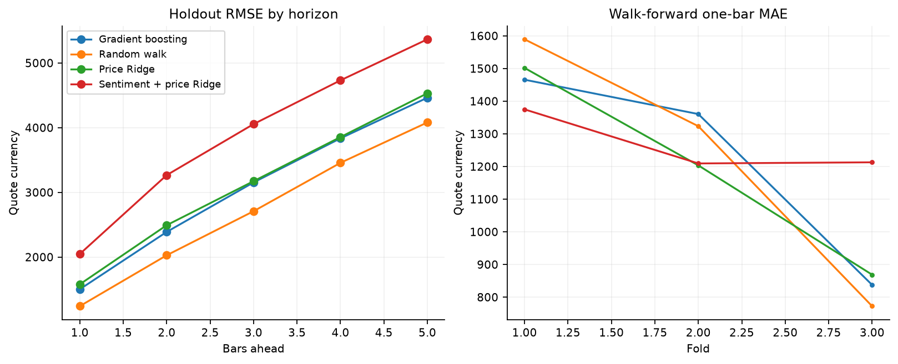
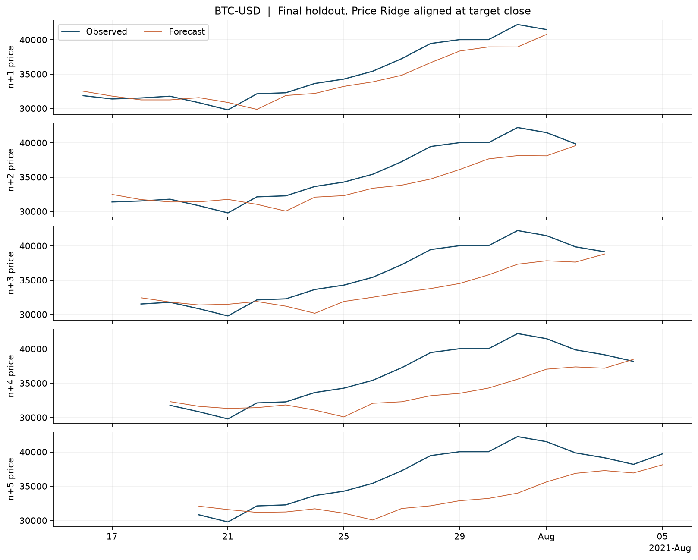
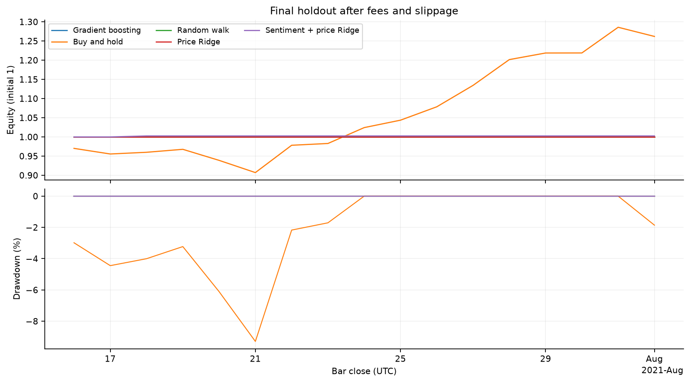

# BTC-USD | Supplementary StockTwits research

**REAL HISTORICAL**. Adding StockTwits sentiment to Ridge reduced walk-forward MAE at 0/5 horizons and RMSE at 0/5. On the final holdout the counts were 0/5 and 0/5. At 0/5 horizons the paired holdout interval for MAE reduction lay entirely above zero. The sample provides no clear evidence of a repeatable reduction in absolute forecast error.

**Validation selected price_only** by pooled forward log-return RMSE with equal weight per origin and horizon. Selection scores used only walk-forward labels maturing before the final holdout. The model was then frozen for the final block.

## Data and availability

The 1d sample contains 180 completed bars from 2021-02-07T00:00:00+00:00 through 2021-08-05T00:00:00+00:00. 11,004 source posts yielded 2,140 scored observations. ID duplicates within the aligned window totalled 0, repeated cleaned texts 0, and empty or off-topic texts 0. After 72 bars of warmup, 108 origins remained, including 77 without posts. Coverage was 28.7%. 103 origins had all five matured targets. Price sources: coinbase_daily_from_hourly.

The public S3 systematic byte-range sample contains BTC.X-tagged messages with user-supplied bullish/bearish labels. The experiment uses date precision with a two-day UTC availability delay and strict-before-close binning. Text was not present in the label files. Labelled users are self-selected. Price bars are full UTC days aggregated from the historical hourly Coinbase candles.

Posts are grouped strictly before each close. A reported availability time delays a post. The run used the publication policy. Publication-time reconstruction assumes archived text could have been read at publication. Retrospective deletions, edits and collection delays remain unobservable. First-seen mode requires a collector observation before the origin. Engagement, follower snapshots, exchange volume and news are excluded from both model matrices.

## Sentiment and supervised models

The sentiment engine was StockTwits self-declared binary label. FinBERT uses positive minus negative softmax probability and the most likely class. The lightweight VADER option uses normalized lexical weights and a ±0.05 polarity band. StockTwits uses its own binary label. Missing intervals retain undefined sentiment, zero sampled posts and an explicit presence indicator. Returns, acceleration, trading ranges, rolling extremes, volatility and moving-average ratios use trailing prices. Sentiment aggregates include dispersion, proportions, imbalance, lags, momentum and log counts. Observed neutral posts remain in their interval.

Five direct targets are log(close[t+h]/close[t]). Multiplying the observed n+0 close by the exponential of each predicted return gives the price forecast. Random walk, price Ridge, price + sentiment Ridge (alpha 100) and five regularized gradient-boosting estimators use identical origins. Ridge fits median imputation, missingness indicators and scaling separately on each training fold. Boosting handles missing values natively, with 45 iterations, at most seven leaves and fixed seed. Observable future closes provide supervised labels. Learning a reinforcement policy would require an execution and reward environment that these data do not identify.

## Expanding-window evaluation

The table gives realized fold sizes. Each fit purges five origins plus 0 embargo bars. The last development test label also precedes the first final holdout origin. Model settings were fixed. The final block is held out within this protocol. This repository had previously evaluated an earlier specification on the historical period, which limits its status as independently unseen evidence.

| fold | phase | train_rows | test_rows | last_train_label | test_start | last_test_label |
| --- | --- | --- | --- | --- | --- | --- |
| 1 | walk_forward | 48 | 10 | 2021-06-11T00:00:00+00:00 | 2021-06-12T00:00:00+00:00 | 2021-06-26T00:00:00+00:00 |
| 2 | walk_forward | 58 | 10 | 2021-06-21T00:00:00+00:00 | 2021-06-22T00:00:00+00:00 | 2021-07-06T00:00:00+00:00 |
| 3 | walk_forward | 68 | 8 | 2021-07-01T00:00:00+00:00 | 2021-07-02T00:00:00+00:00 | 2021-07-14T00:00:00+00:00 |
| 4 | holdout | 81 | 17 | 2021-07-14T00:00:00+00:00 | 2021-07-15T00:00:00+00:00 | 2021-08-05T00:00:00+00:00 |

## Incremental value of sentiment

Adding StockTwits sentiment to Ridge reduced walk-forward MAE at 0/5 horizons and RMSE at 0/5. On the final holdout the counts were 0/5 and 0/5. At 0/5 horizons the paired holdout interval for MAE reduction lay entirely above zero. The sample provides no clear evidence of a repeatable reduction in absolute forecast error. Positive gains favor adding sentiment. Direction gains are percentage points. Paired 95% percentile intervals use 500 circular moving-block resamples of the absolute loss difference. Block lengths exceed or equal the forecast horizon. Intervals are descriptive and unadjusted for testing multiple horizons. Fold wins count lower MAE.

| phase | horizon | rmse_gain_usd | mae_gain_usd | direction_gain_pp | mae_ci_low | mae_ci_high | block_bars | winning_folds | folds |
| --- | --- | --- | --- | --- | --- | --- | --- | --- | --- |
| holdout | 1 | -468.5044 | -389.5621 | 5.8824 | -680.2432 | -69.7238 | 3 | 0 | 1 |
| holdout | 2 | -774.3278 | -558.1073 | -5.8824 | -1077.7067 | 56.8712 | 3 | 0 | 1 |
| holdout | 3 | -882.2775 | -712.7893 | -17.6471 | -1182.1007 | -323.6401 | 3 | 0 | 1 |
| holdout | 4 | -877.0444 | -649.9144 | -23.5294 | -1189.5541 | -167.9382 | 4 | 0 | 1 |
| holdout | 5 | -834.4319 | -595.3362 | 0.0000 | -1336.0202 | 28.9972 | 5 | 0 | 1 |
| walk_forward | 1 | -30.7886 | -55.0685 | 0.0000 | -195.6182 | 77.6090 | 4 | 1 | 3 |
| walk_forward | 2 | -58.5994 | -130.2716 | 3.5714 | -327.3153 | 51.2593 | 4 | 2 | 3 |
| walk_forward | 3 | -190.3884 | -302.7589 | 0.0000 | -676.6335 | -16.5353 | 4 | 1 | 3 |
| walk_forward | 4 | -156.5798 | -287.6100 | 7.1429 | -738.8913 | 63.8332 | 4 | 1 | 3 |
| walk_forward | 5 | -269.6597 | -403.6537 | 7.1429 | -943.2882 | 21.2556 | 5 | 1 | 3 |

## Out-of-sample forecast errors

MAE, RMSE and mean signed error use price units. Both price-level and return R² are reported because a persistent price level can produce a high R² with little return predictability. Direction is exact sign agreement, including a zero-return forecast. Positive MAE skill indicates an improvement over random walk.

| phase | model | horizon | n | mae_usd | rmse_usd | r2_price | r2_return | mean_error_usd | direction_accuracy | mae_skill_vs_persistence |
| --- | --- | --- | --- | --- | --- | --- | --- | --- | --- | --- |
| holdout | boosting | 1 | 17 | 1196.9044 | 1502.5195 | 0.8620 | -0.6590 | -803.9783 | 0.2941 | -0.1965 |
| holdout | boosting | 2 | 17 | 1971.9687 | 2388.8948 | 0.6627 | -0.7521 | -1357.6862 | 0.4706 | -0.1059 |
| holdout | boosting | 3 | 17 | 2464.1436 | 3154.2116 | 0.3970 | -0.8559 | -1948.6395 | 0.6471 | -0.0950 |
| holdout | boosting | 4 | 17 | 3006.7549 | 3835.5357 | 0.0501 | -0.7022 | -2350.7302 | 0.6471 | -0.0517 |
| holdout | boosting | 5 | 17 | 3503.9176 | 4463.0724 | -0.3537 | -0.7420 | -2864.2581 | 0.5882 | -0.0338 |
| holdout | persistence | 1 | 17 | 1000.3141 | 1241.5910 | 0.9057 | -0.1785 | -510.5071 | 0.0000 | 0.0000 |
| holdout | persistence | 2 | 17 | 1783.2100 | 2027.8552 | 0.7570 | -0.2908 | -980.9029 | 0.0000 | 0.0000 |
| holdout | persistence | 3 | 17 | 2250.2965 | 2709.0227 | 0.5552 | -0.3892 | -1437.4635 | 0.0000 | 0.0000 |
| holdout | persistence | 4 | 17 | 2858.8171 | 3456.9457 | 0.2284 | -0.4004 | -1829.0829 | 0.0000 | 0.0000 |
| holdout | persistence | 5 | 17 | 3389.4371 | 4081.0063 | -0.1319 | -0.4719 | -2295.7982 | 0.0000 | 0.0000 |
| holdout | price_only | 1 | 17 | 1314.3444 | 1579.1166 | 0.8475 | -0.7893 | -975.1621 | 0.2941 | -0.3139 |
| holdout | price_only | 2 | 17 | 2077.2724 | 2492.4167 | 0.6329 | -0.8576 | -1625.8783 | 0.5294 | -0.1649 |
| holdout | price_only | 3 | 17 | 2582.0867 | 3173.3639 | 0.3896 | -0.8476 | -2206.5807 | 0.5294 | -0.1474 |
| holdout | price_only | 4 | 17 | 3142.0635 | 3854.7503 | 0.0406 | -0.7229 | -2770.3795 | 0.5882 | -0.0991 |
| holdout | price_only | 5 | 17 | 3768.9215 | 4531.8149 | -0.3958 | -0.8048 | -3408.0593 | 0.4118 | -0.1120 |
| holdout | sentiment_price | 1 | 17 | 1703.9065 | 2047.6210 | 0.7437 | -2.0506 | -1438.6854 | 0.3529 | -0.7034 |
| holdout | sentiment_price | 2 | 17 | 2635.3797 | 3266.7444 | 0.3693 | -2.2130 | -2380.8402 | 0.4706 | -0.4779 |
| holdout | sentiment_price | 3 | 17 | 3294.8760 | 4055.6414 | 0.0031 | -2.1054 | -3026.7136 | 0.3529 | -0.4642 |
| holdout | sentiment_price | 4 | 17 | 3791.9779 | 4731.7947 | -0.4457 | -1.6552 | -3556.6913 | 0.3529 | -0.3264 |
| holdout | sentiment_price | 5 | 17 | 4364.2577 | 5366.2469 | -0.9571 | -1.5764 | -4140.5842 | 0.4118 | -0.2876 |
| walk_forward | boosting | 1 | 28 | 1248.7487 | 1592.4638 | 0.5224 | 0.0007 | -152.2604 | 0.5000 | 0.0098 |
| walk_forward | boosting | 2 | 28 | 1792.1016 | 2105.9984 | 0.1751 | -0.0084 | -372.4684 | 0.5357 | 0.0098 |
| walk_forward | boosting | 3 | 28 | 1681.9704 | 2250.2963 | -0.0597 | -0.0026 | -477.7675 | 0.6786 | 0.0975 |
| walk_forward | boosting | 4 | 28 | 1676.7678 | 2260.3827 | -0.4072 | 0.0197 | -426.3533 | 0.6071 | 0.0284 |
| walk_forward | boosting | 5 | 28 | 1880.2772 | 2325.0177 | -1.1281 | 0.0525 | -376.0925 | 0.5714 | 0.0158 |
| walk_forward | persistence | 1 | 28 | 1261.0600 | 1603.6076 | 0.5157 | -0.0059 | 125.5064 | 0.0000 | 0.0000 |
| walk_forward | persistence | 2 | 28 | 1809.9007 | 2120.3460 | 0.1638 | -0.0089 | 198.4343 | 0.0000 | 0.0000 |
| walk_forward | persistence | 3 | 28 | 1863.6596 | 2305.2982 | -0.1121 | -0.0258 | 368.2918 | 0.0000 | 0.0000 |
| walk_forward | persistence | 4 | 28 | 1725.8529 | 2416.9061 | -0.6088 | -0.0717 | 634.3050 | 0.0000 | 0.0000 |
| walk_forward | persistence | 5 | 28 | 1910.5339 | 2619.9315 | -1.7023 | -0.1275 | 899.5989 | 0.0000 | 0.0000 |
| walk_forward | price_only | 1 | 28 | 1214.4572 | 1567.1312 | 0.5375 | 0.0417 | -259.7933 | 0.5714 | 0.0370 |
| walk_forward | price_only | 2 | 28 | 1629.5892 | 1997.5910 | 0.2579 | 0.1095 | -447.0353 | 0.6071 | 0.0996 |
| walk_forward | price_only | 3 | 28 | 1497.7397 | 2113.6448 | 0.0651 | 0.1381 | -596.8172 | 0.7500 | 0.1963 |
| walk_forward | price_only | 4 | 28 | 1482.9449 | 2072.7486 | -0.1833 | 0.1847 | -512.4346 | 0.6071 | 0.1407 |
| walk_forward | price_only | 5 | 28 | 1588.7905 | 2048.8956 | -0.6527 | 0.2666 | -500.8870 | 0.5714 | 0.1684 |
| walk_forward | sentiment_price | 1 | 28 | 1269.5257 | 1597.9197 | 0.5191 | -0.0121 | -345.9320 | 0.5714 | -0.0067 |
| walk_forward | sentiment_price | 2 | 28 | 1759.8608 | 2056.1904 | 0.2137 | 0.0487 | -620.0807 | 0.6429 | 0.0276 |
| walk_forward | sentiment_price | 3 | 28 | 1800.4985 | 2304.0331 | -0.1109 | -0.0640 | -847.6696 | 0.7500 | 0.0339 |
| walk_forward | sentiment_price | 4 | 28 | 1770.5549 | 2229.3283 | -0.3688 | 0.0293 | -674.0752 | 0.6786 | -0.0259 |
| walk_forward | sentiment_price | 5 | 28 | 1992.4442 | 2318.5553 | -1.1163 | 0.0396 | -566.7879 | 0.6429 | -0.0429 |

## Trading simulation

The one-bar forecast sets a long/cash position. Each training fold sets the entry threshold to the larger of the median absolute one-bar training log return and two one-way costs. Enter at the next bar open, liquidate at its close, with unit maximum exposure and no borrowing. One-way cost is 10 bp including 2 bp of slippage. Each active bar is one round trip, even for consecutive signals. The historical opening print is a fill assumption, especially for adjacent crypto bars. Buy-and-hold enters once and exits once per phase. Sharpe uses sample standard deviation and 365 periods per year. Sortino uses the root mean squared negative return across all bars. Both use a zero hurdle. Drawdown includes initial wealth. Gross and net are reported separately. Annualized growth rates extrapolate short samples.

**Selected model, final holdout, net of costs**

| phase | model | basis | sharpe | sortino | max_drawdown | total_return | annualized_return | bars | trades | win_rate | turnover | exposure |
| --- | --- | --- | --- | --- | --- | --- | --- | --- | --- | --- | --- | --- |
| holdout | price_only | net | N/A | N/A | 0.0000 | 0.0000 | 0.0000 | 17 | 0 | N/A | 0.0000 | 0.0000 |

| phase | model | basis | sharpe | sortino | max_drawdown | total_return | annualized_return | bars | trades | win_rate | turnover | exposure |
| --- | --- | --- | --- | --- | --- | --- | --- | --- | --- | --- | --- | --- |
| holdout | boosting | gross | N/A | N/A | 0.0000 | 0.0000 | 0.0000 | 17 | 0 | N/A | 0.0000 | 0.0000 |
| holdout | boosting | net | N/A | N/A | 0.0000 | 0.0000 | 0.0000 | 17 | 0 | N/A | 0.0000 | 0.0000 |
| holdout | persistence | gross | N/A | N/A | 0.0000 | 0.0000 | 0.0000 | 17 | 0 | N/A | 0.0000 | 0.0000 |
| holdout | persistence | net | N/A | N/A | 0.0000 | 0.0000 | 0.0000 | 17 | 0 | N/A | 0.0000 | 0.0000 |
| holdout | buy_hold | gross | 8.0515 | 19.4934 | -0.0920 | 0.2645 | 153.2210 | 17 | 1 | 1.0000 | 2.0000 | 1.0000 |
| holdout | buy_hold | net | 7.9560 | 19.0808 | -0.0929 | 0.2620 | 146.7356 | 17 | 1 | 1.0000 | 2.0000 | 1.0000 |
| holdout | price_only | gross | N/A | N/A | 0.0000 | 0.0000 | 0.0000 | 17 | 0 | N/A | 0.0000 | 0.0000 |
| holdout | price_only | net | N/A | N/A | 0.0000 | 0.0000 | 0.0000 | 17 | 0 | N/A | 0.0000 | 0.0000 |
| holdout | sentiment_price | gross | 4.6336 | N/A | 0.0000 | 0.0046 | 0.1035 | 17 | 1 | 1.0000 | 2.0000 | 0.0588 |
| holdout | sentiment_price | net | 4.6336 | N/A | 0.0000 | 0.0026 | 0.0571 | 17 | 1 | 1.0000 | 2.0000 | 0.0588 |
| walk_forward | boosting | gross | N/A | N/A | 0.0000 | 0.0000 | 0.0000 | 28 | 0 | N/A | 0.0000 | 0.0000 |
| walk_forward | boosting | net | N/A | N/A | 0.0000 | 0.0000 | 0.0000 | 28 | 0 | N/A | 0.0000 | 0.0000 |
| walk_forward | persistence | gross | N/A | N/A | 0.0000 | 0.0000 | 0.0000 | 28 | 0 | N/A | 0.0000 | 0.0000 |
| walk_forward | persistence | net | N/A | N/A | 0.0000 | 0.0000 | 0.0000 | 28 | 0 | N/A | 0.0000 | 0.0000 |
| walk_forward | buy_hold | gross | -1.0281 | -1.3651 | -0.2206 | -0.0942 | -0.7245 | 28 | 1 | 0.0000 | 2.0000 | 1.0000 |
| walk_forward | buy_hold | net | -1.0571 | -1.4021 | -0.2206 | -0.0960 | -0.7316 | 28 | 1 | 0.0000 | 2.0000 | 1.0000 |
| walk_forward | price_only | gross | N/A | N/A | 0.0000 | 0.0000 | 0.0000 | 28 | 0 | N/A | 0.0000 | 0.0000 |
| walk_forward | price_only | net | N/A | N/A | 0.0000 | 0.0000 | 0.0000 | 28 | 0 | N/A | 0.0000 | 0.0000 |
| walk_forward | sentiment_price | gross | 3.6105 | N/A | 0.0000 | 0.0215 | 0.3202 | 28 | 1 | 1.0000 | 2.0000 | 0.0357 |
| walk_forward | sentiment_price | net | 3.6105 | N/A | 0.0000 | 0.0195 | 0.2863 | 28 | 1 | 1.0000 | 2.0000 | 0.0357 |

## Limitations and reproduction

Capped sampling, sparse coverage, changing regimes and domain mismatch can swamp small sentiment effects. Repeated texts, multilingual posts, quoted prices and bots complicate interpretation. FinBERT scores in this retrospective reconstruction use a pinned model artifact distributed after the 2021 sample. They do not establish that this exact text model was deployable at each origin. Correlation does not identify information arrival or causation. A historical backtest cannot establish present market sentiment. News is retrieved separately for dated outlooks.

The manifest records the exact feature order, model parameters, input and software hashes, provider runs, forecast cutoffs and engine version. The README gives the offline replay, public-source rebuild and credential-gated collection commands. See forecast_metrics.csv, fold_metrics.csv, incremental.csv, trades.csv and the forecast matrix for machine-readable results.
